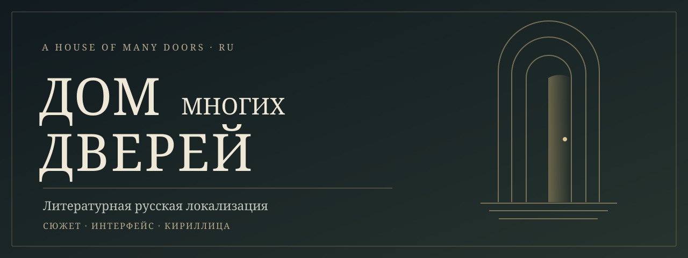

<div align="center">

# Дом многих дверей

### Литературная русификация A House of Many Doors

Сохранить голос Дома: его мрачный юмор, странных обитателей и истории.


[Готовность](#готовность) · [Что уже сделано](#что-уже-сделано) · [Разработка](docs/BUILD.md) · [План](ROADMAP.md) · [English](#english)

</div>



**Полный русский перевод A House of Many Doors — цель проекта.** Сейчас готова часть текста, разработан способ подключения перевода, подготовлены кириллические шрифты и русские элементы интерфейса.

## Готовность

**Проект в работе. Готового пользовательского выпуска пока нет.** Оценка покрытия текста — **около 35%**. Последняя локальная сборка проверена статически 15 октября 2026 года; документация оформлена 31 октября. Игровое тестирование отложено до завершения перевода по решению владельца.

| Показатель | Подтверждённое состояние |
|:---|:---|
| Основные корабельные диалоги | Все 35 сценариев переведены |
| Словарь | 13 723 записи с учётом сгенерированных вариантов |
| Кириллица | 49 шрифтов; 154 необходимых символа проверены |
| Журнал / сохранения | 421 / 696 проверенных вариантов |
| Графические подписи UI | 13 семейств, 56 сочетаний надписи и кадра |
| Исходные строки | 61 749 сохранены без изменения |
| Игровой тест / финальная вычитка | Предстоят |

35% — приблизительная оценка по объёму уникальных текстовых фрагментов исходного кода, с учётом переведённых частей составных реплик. Это около 201 тысячи исходных слов из 569 тысяч кандидатов. Короткие подписи и часть динамических случаев метод учитывает неполно; возможны неиспользуемые строки. 218 358 слов в полном словаре включают повторы и варианты и не служат числителем процента. [Данные и границы оценки](docs/status.json).

## Что уже сделано

- Все 35 основных корабельных диалогов спутников; ряд их заданий и развязок.
- Обучение, прибытие, инвентарь, газеты и значительная часть начальных сюжетных блоков.
- Главное меню, название «Дом многих дверей», основные меню и подсказки, боевые надписи, карта, журнал и сохранения.
- Georgia и Cormorant Garamond с кириллицей; отдельная типографика заголовка и размещение русских надписей в интерфейсе.
- Шаблоны целых реплик с числами, местоимениями и именами; сохранение пользовательских имён.
- Глоссарии локаций, персонажей, должностей и повторяющихся терминов.

Каждая строка сохраняет контекст. Головоломки с латинским алфавитом не заменяются механически; каламбуры получают объяснение, когда это необходимо для подсказки.

## Внутри репозитория

```text
work/
  translations*_batch.json  # переводы по устойчивым идентификаторам
  translation_*.json        # составные реплики и шаблоны
  glossary_*.json           # единый словарь
  scripts/                 # извлечение, подготовка, сборка и проверки
docs/
  BUILD.md                 # частная сборочная лаборатория
  ARCHITECTURE.md           # подключение перевода и кириллицы
  TESTING.md                # доказанные результаты и пределы проверок
  status.json              # машиночитаемый срез состояния
```

Оригинальный и изменённый архив игры, извлечённый код, изображения, системные шрифты и сохранения сюда не включены. Текстовые ключи в данных перевода используются для сопоставления с собственной копией игры. Нужна легальная копия [A House of Many Doors в Steam](https://store.steampowered.com/app/437250/).

## Разработка

Проект использует UndertaleModCli 0.9.2, Python и Pillow. Сборочные исходники и ресурсы извлекаются локально из собственной игры и остаются в игнорируемых каталогах. Подробности: [BUILD.md](docs/BUILD.md).

Публичный снимок инструментов адаптирован к относительным путям. Полная сборка из чистого публичного клона ещё не проверена; подтверждённые результаты относятся к исходной частной лаборатории. Публичный репозиторий не устанавливает промежуточную версию в Steam.

[Архитектура](docs/ARCHITECTURE.md) · [Проверки](docs/TESTING.md) · [Правила вклада](CONTRIBUTING.md) · [План](ROADMAP.md) · [История](CHANGELOG.md) · [Права и авторство](RIGHTS.md)

## English

An in-progress literary Russian localization of **A House of Many Doors**. About **35% of candidate source text** is covered; this is a heuristic text-volume estimate, not release readiness. All 35 main onboard companion dialogue scripts are translated. Cyrillic typography, the Russian title and major interface elements are prepared.

The last local binary passed static checks on October 15, 2026. Gameplay testing and full editorial review remain pending. This public repository contains translation data, original localization tooling and documentation, but no game archives, decompiled source exports, extracted textures or saves. A clean-clone build is not yet verified. There is no installable public release.

Prepared with AI assistance from Codex and Universal Modder tooling. Original game and third-party rights remain with their owners; see [RIGHTS.md](RIGHTS.md).
