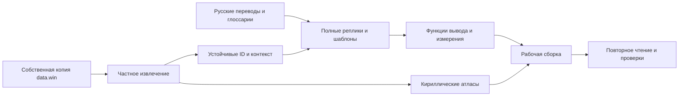

# Архитектура локализации

GameMaker Studio VM, байткод 15. Оригинальные 61 749 строк используются и как текст, и как внутренние идентификаторы. Локализация переводит значения на пути рисования и измерения; сохранения и исходная таблица строк остаются неизменными.

## Поток данных

`prepare_translation.py` создаёт GML-словарь на switch и функции вывода. Старый путь с инициализацией ds_map не используется: в прежней реализации он приводил к сбою. Новые вызовы регистрируются до перенаправления.

## Имена, числа и грамматика

Динамические предложения переводятся целиком. Числовые шаблоны принимают только допустимые счётчики; имена игрока и пользовательские имена сохраняются. В сообщениях о потерях используются нейтральные конструкции, поддерживающие исходные his/her/its, включая мицен. Полная локализация процедурных имён и грамматики стихов остаётся отдельной задачей.

## Типографика

48 исходных шрифтов получают дополнительные кириллические символы. fRUtitle — отдельный Cormorant Garamond для русского названия. Родные латинские метрики и необходимые для головоломок буквы сохраняются.

Графические подписи 13 семейств интерфейса заменяются нативным текстом с сохранением окружающей графики и координат кадра. Раскрытие записной книжки имеет 20 раскладок. Экспортированные картинки обрезаны: их нельзя измерять без target-offset полного спрайта.

Эта версия GameMaker не поддерживает getters шрифта и выравнивания. Обёртки setter-вызовов хранят состояние, которое восстанавливается после отрисовки UI. Дата журнала локализуется отдельно от тела записи; высота сохранений измеряется с переносом строк.
